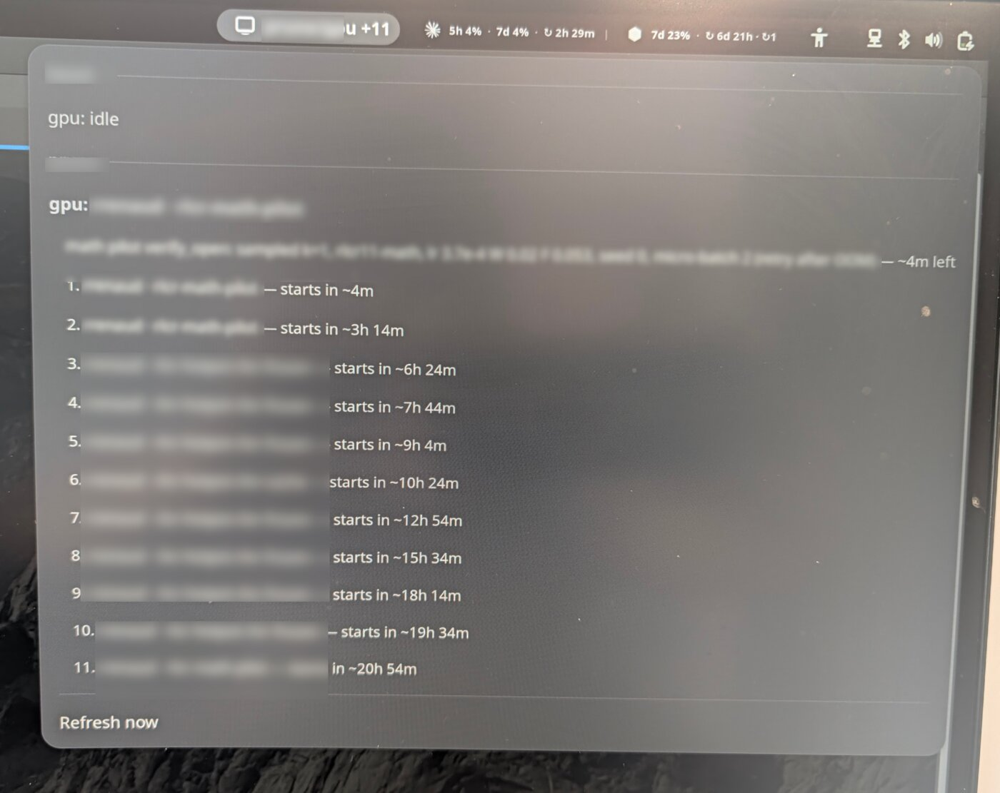

<!-- SPDX-License-Identifier: MIT -->
# gpuq GNOME Shell extension

Shows gpuq reservations, queued experiments and live GPU telemetry in the
top bar, e.g. `gpu 91% +1` (busy at 91%, one run waiting). The menu lists
each host's active run, remaining estimate, gputop stats and FIFO queue.

It polls one or more commands that print `gpuq snapshot` JSON, so remote
hosts work through ssh with key-based, non-interactive login:

~~~sh
./install.sh
gnome-extensions enable gpuq@mcgrof.github.io   # after re-login on Wayland
gsettings --schemadir ~/.local/share/gnome-shell/extensions/gpuq@mcgrof.github.io/schemas \
  set org.gnome.shell.extensions.gpuq sources \
  "['ssh -o BatchMode=yes node-a GPUQ_CONFIG=/path/to/config.json gpuq snapshot']"
~~~

GNOME Shell does not read your shell profile: use absolute paths and set
`GPUQ_CONFIG` inside the command. Preferences offer the same settings.

Inspired by the
[AI Usage (Claude + Codex) extension](https://github.com/mcgrof/gnome-shell-extension-claude-usage),
which polls a helper command in the same way.
